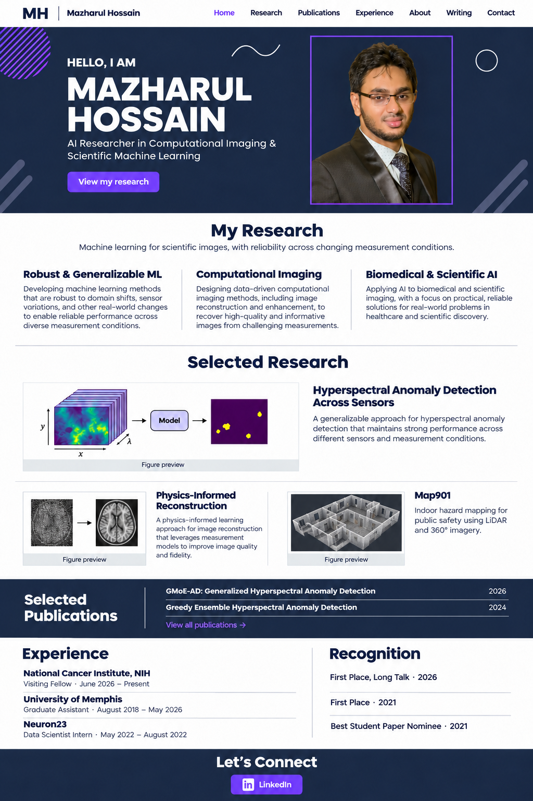

# Stylesheet refinement reference

Prepared November 8, 2026. Status is a visual proposal awaiting implementation approval. This brief supports DESIGN-01 in the [active optimization plan](BUNDLE_OPTIMIZATION_PLAN.md). The [README contracts](../README.md#behavioral-contracts) govern behavior and verification.

## Aim

Create stronger dark-and-white contrast while reusing the current Unfold theme, Poppins typography, purple accents, existing layout and stylesheet structure. Reduce the repeated lavender panels and purple-topped cards that currently give unrelated sections the same visual treatment. Keep implementation small and review one group of sections at a time.

## Reference image

The image illustrates contrast and less boxed presentation. It is an AI-generated concept, not a rendered implementation or content source. Its scientific figures are illustrative previews. Use the actual approved site text, portrait, figures, captions, five selected publications and all current sections during implementation. About and Writing are omitted from this condensed sample, not from the intended page. Keep the existing navbar branding and figure grid rather than copying the sample's monogram, image arrangement or compressed spacing. Use flat theme colors even where the generated sample contains shading. The first generated version contained incorrect employment labels and a Map901 description; this saved version corrects those labels. Authoritative content continues to come from the site's records.

## Existing palette and ownership

| Role | Existing value / source | Proposed use |
| --- | --- | --- |
| Dark surface | `#1c2940`, footer theme | Hero and existing footer; optionally Publications after initial visual review |
| Reading surface | `#fff` | Main content sections and open layouts |
| Accent | `#754ef9` | Existing buttons, links, active navigation and selected hero shapes |
| Body text | `#626a7a` | Existing light-surface paragraphs |
| Dark-surface text | `#fff` | Hero headings and text, with contrast checked for secondary labels |
| Dividers | Existing light neutral borders | Discrete separation between repeated entries |

Add a small set of semantic CSS custom properties in the loaded `src/assets/css/style.css` for the shared values touched by this work. Migrate touched declarations only. Keep feature rules in their current component stylesheets. Reuse Bootstrap grids and existing spacing utilities. Avoid a parallel theme stylesheet, broad overrides, specificity escalation or unrelated formatting.

## First implementation batch

| Section / owning styles | Small proposed change | Reuse |
| --- | --- | --- |
| Hero, `src/assets/css/style.css` and `src/app/index-page/index-page.component.css` | Use the existing navy for the hero surface and scoped light text; assess each shape and portrait-frame contrast against it | Current two-column layout, portrait, moving shapes, purple CTA and Poppins |
| Research overview, `src/app/home/research-overview/research-overview.component.css` | Use a white section and open text columns; remove the purple top bars and individual white-box backgrounds | Existing three-column responsive grid and headings; reduce padding only if visual comparison supports it |
| Experience and Recognition, `src/app/home/research-journey/research-journey.component.css` | Present entries as open rows with restrained separators; neutralize the service-card border, radius, background and hover shadow within this component | Existing employment/recognition columns, mobile stacking, content and entry spacing |

Review this batch before extending the treatment to other sections. Make shared changes only where the rule genuinely applies to multiple sections. In particular, changing global `.single-service` would affect other pages, so scope any visual reset to Experience.

## Subsequent batches

- Selected Research can retain its current grid, figure sizes and captions while removing excessive outer boxes and lavender figure-area surfaces. Use actual scientific imagery as emphasis. Do not adopt the sample's invented diagrams or remove attribution.
- About can retain its biography/skills columns while reducing the skills panel's lavender fill and purple top border.
- Writing can retain its existing grid and previews while reducing the purple top bars and panel fill. Check loading, failure and full-archive states as well as successful homepage previews.
- Publications already uses compact rows. Keep its current layout initially. A navy section is an optional later comparison, requiring readable links, years and focus indicators.
- Contact and footer already provide established theme patterns. Adjust only where a rendered comparison identifies a mismatch.

## Verification and acceptance

1. Capture the current desktop and mobile page before each batch, including 360px, open menu, long headings and captions.
2. Compare the rendered result using current real content. Confirm darker sections have readable text, links, purple buttons and visible keyboard focus. Confirm the portrait and moving shapes remain visible and behave as intended.
3. Check document overflow, intentional Works gallery scrolling, section-heading clearance, standalone pages, reduced-motion CSS and the existing intentional JS motion.
4. Run the applicable compiler, guidance and browser checks from the manifest. Preserve existing regression coverage for navigation, URL/metadata behavior and Back-to-top. Keep unaddressed test failures recorded in the active plan rather than attributing them to a visual pass.
5. Review the stylesheet diff. Prefer scoped declaration changes over new wrappers, layout rewrites or duplicate theme rules. Any necessary template/class change requires explicit justification in that batch.
6. Record changed selectors and before/after screenshots for manual review. Do not claim the image alone proves responsive behavior, accessibility or performance.

This task creates the plan and reference asset. Implementation, commits and deployment require a subsequent request.
